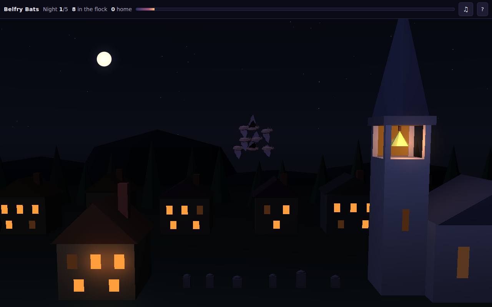

# Belfry Bats

**Play it: https://belfry-bats.play.danielstephenson.dev** (desktop or phone, in the browser)



A small Halloween game. The night is nearly over, and a flock of bats has to get home to the old church's bell tower
before the sky gets light. The flock follows your finger or your mouse, flocking like real bats (boids: each bat keeps
apart from its neighbours, flies the way they fly, and stays with the group). Swoop through the gaps between trees and
chimneys, keep clear of the owls on watch, and gather the stray bats hanging from eaves and branches along the way.

- **The dawn is the timer.** The sky lightens from deep night to first light (real sun positions for a New England
  morning on 1 November), and the bar at the top fills with it.
- **Five nights**, each one longer and trickier: more owls, taller pines, closer gaps. Each night is the same for
  everyone, so a family can compare scores.
- **Score = bats brought home**, over all five nights. Your best stays in your browser.
- **Bumps are gentle.** A bat that hits a roof is dazed and drops behind; fly back past it and it rejoins. Only a bat
  left far behind, or one an owl frightens off, is lost for the night.
- **Sound**, all synthesised: the flock's wingbeats, chirps as strays join, owls, the first birds, and the church bell.

## Controls

| | Desktop | Phone or tablet |
|---|---|---|
| Lead the flock | Move the mouse ahead of it (or hold the arrow keys / WASD) | Hold a finger ahead of it |
| Let them circle | Move the mouse off the game | Lift your finger |
| Sound | `M` or the &#9835; button | The &#9835; button |

## How it is built

- `src/sim/`: the night, with no engine: the village for each night (`level.cpp`, from fixed seeds), the flock and the
  owls (`world.cpp`, fixed 60 Hz steps, deterministic), and a simple pilot (`autopilot.cpp`) that the tests use to show
  every night can be won.
- `src/audio/`: the sounds, synthesised from the world's events (no recordings), played through miniaudio (Web Audio).
- `src/play/`: the picture, on [Strata](https://github.com/Preponderous-Software/strata) v0.7.0 (WebGL 2): the village as
  a few flat-shaded meshes, each bat and owl a body and two wings moved by model matrices, Strata's sky with the sun
  below the horizon, point lights for the windows and the belfry's lantern.
- `app/web_main.cpp` and `web/shell.html`: the browser page, behind Strata's web kit loading shell.

The flock is capped at 32 bats, with no shadow maps, so it stays smooth on a phone.

### Build and test

The rules and their tests need only a C++17 compiler and CMake:

```sh
cmake -S . -B build && cmake --build build -j && ctest --test-dir build --output-on-failure
```

The browser game needs emsdk 6.0.11 (Strata's pin):

```sh
emcmake cmake -S . -B build-web -DBELFRY_WEB=ON && cmake --build build-web -j
# then serve build-web/ (belfry-bats.html, .js, .wasm) over HTTP
```

CI (`.github/workflows/browser.yml`) builds the page, runs the tests as wasm under Node, smoke-tests it in headless
Chromium on a desktop and an iPhone 13 profile (`web/smoke/smoke.cjs`), checks the layout on four more phones
(`web/smoke/layout.cjs`), and deploys `main` to the arcade.

## Licence

MIT; see [LICENSE](LICENSE). miniaudio (`third_party/miniaudio/`) is public domain (or MIT No Attribution).

---

drafted by Claude on behalf of Daniel Stephenson
